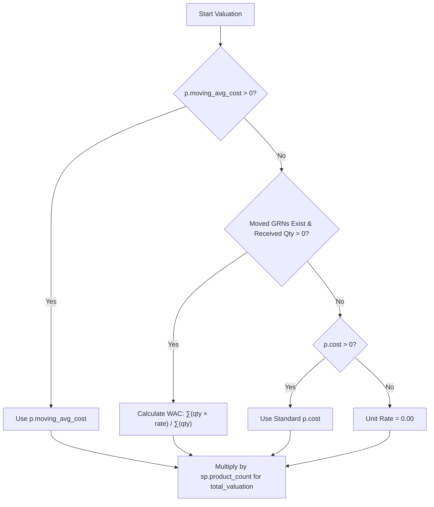

# DevOps Release & Database Migration Instructions: Weighted Average Cost (WAC) Stock Valuation

**Date:** 2026-09-16  
**Target Tables:** `products` (schema alter & update), `grnotes`, `grnlineitems` (read)  
**Target Services:** `Base_Config`, `invregistry`  

---

## 1. Overview & Objectives

This release transitions inventory stock valuation from the single **Latest Purchase Price (Latest GRN)** fallback to the industry-standard **Moving Weighted Average Cost (WAC / AVCO)**.

### Key Highlights:
1. **Schema Update**: Adds a new column `moving_avg_cost NUMERIC(15, 4)` and a partial index on `products`.
2. **Historical Data Migration**: Backfills `moving_avg_cost` across all active products based on total historical GRN received quantities and purchase rates for approved, inwarded stock (`gn.is_moved = true`).
3. **Dynamic Valuation Fallback**: In the stock list query, if `p.moving_avg_cost` is unset or `0`, WAC is calculated dynamically on-the-fly from moved GRNs (`gn.is_moved is true`), falling back to standard product cost `p.cost`.
4. **Backward Compatibility**: The `/am-invregistry/stocklist/` endpoint returns the new `weighted_avg_rate` and preserves `last_grn_rate` (aliased to the weighted average rate). Existing frontend components automatically display accurate valuation figures without breaking.

---

## 2. Valuation Logic & Priority Hierarchy

The valuation unit rate for each product in `/am-invregistry/stocklist/` is evaluated using the following priority chain:

$$\text{Unit Rate} = \text{COALESCE}\big(\text{NULLIF}(p.\text{moving\_avg\_cost}, 0),\ \text{NULLIF}(\text{grn\_rate}.\text{weighted\_avg\_rate}, 0),\ p.\text{cost},\ 0\big)$$

$$\text{Total Valuation} = \text{product\_count} \times \text{Unit Rate}$$



### Key Query Details:
- **Moved GRN items only**: Only GRNs that have been inwarded/moved into stores (`gn.is_moved is true` and `gn.deleted is not true`) contribute to the average cost.
- **Sanitization of `rate_per_item`**: `regexp_replace(gli.rate_per_item, '[^0-9.]', '', 'g')::numeric` ensures non-numeric characters (currency signs, spaces) in `VARCHAR(50)` do not cause casting exceptions.

---

## 3. Pre-Migration Audit Queries

Run these queries **before** executing the backfill script to inspect the current state and preview calculated WAC rates:

### A. Summary of Products & Valuation Readiness
```sql
SELECT 
    COUNT(*) AS total_active_products,
    COUNT(CASE WHEN cost IS NOT NULL AND cost > 0 THEN 1 END) AS products_with_standard_cost,
    COUNT(DISTINCT gli.product_id) AS products_with_grn_history
FROM products p
LEFT JOIN grnlineitems gli ON gli.product_id = p.product_id AND gli.deleted IS NOT TRUE
WHERE p.deleted IS NOT TRUE;
```

### B. Preview Calculated Weighted Average Cost vs Standard Cost
```sql
WITH grn_totals AS (
    SELECT 
        gli.product_id,
        gn.compcode,
        SUM(COALESCE(gli.received_quantity, 0)) AS total_qty,
        SUM(
            COALESCE(gli.received_quantity, 0) * 
            COALESCE(NULLIF(regexp_replace(gli.rate_per_item, '[^0-9.]', '', 'g'), '')::numeric, 0)
        ) AS total_val
    FROM grnlineitems gli
    JOIN grnotes gn ON gn.grnotesid = gli.grnotesid
    WHERE gn.deleted IS NOT TRUE 
      AND gli.deleted IS NOT TRUE
      AND gn.is_moved = true
    GROUP BY gli.product_id, gn.compcode
)
SELECT 
    p.product_id,
    p.product_code,
    p.product_name,
    p.compcode,
    COALESCE(p.cost, 0) AS standard_cost,
    COALESCE(gt.total_qty, 0) AS total_grn_qty,
    COALESCE(gt.total_val, 0) AS total_grn_val,
    CASE 
        WHEN COALESCE(gt.total_qty, 0) > 0 
        THEN ROUND(gt.total_val / gt.total_qty, 4)
        ELSE COALESCE(p.cost, 0)
    END AS preview_weighted_avg_cost
FROM products p
LEFT JOIN grn_totals gt ON gt.product_id = p.product_id AND gt.compcode = p.compcode
WHERE p.deleted IS NOT TRUE
ORDER BY gt.total_qty DESC NULLS LAST
LIMIT 20;
```

---

## 4. Database Migration & Backfill Script

Execute the script below in PostgreSQL or run [`2026-09-16_devops_weighted_average_cost_migration.sql`](file:///Users/rajkumarmuthuramalingam/Work/AmNonOvens/2026-09-16_devops_weighted_average_cost_migration.sql):

```bash
psql -h <DB_HOST> -U <DB_USER> -d <DB_NAME> -f 2026-09-16_devops_weighted_average_cost_migration.sql
```

### SQL Execution Script:

```sql
-- ============================================================================
-- 1. SCHEMA MIGRATION: Add moving_avg_cost column to products table
-- ============================================================================
ALTER TABLE products 
ADD COLUMN IF NOT EXISTS moving_avg_cost NUMERIC(15, 4) DEFAULT 0.0000;

-- Partial index for faster cost lookups and queries
CREATE INDEX IF NOT EXISTS idx_products_moving_avg_cost 
ON products (moving_avg_cost) 
WHERE deleted IS NOT TRUE;

-- ============================================================================
-- 2. DATA MIGRATION: Backfill moving_avg_cost for products with inwarded GRNs
-- ============================================================================
WITH grn_calc AS (
    SELECT 
        gli.product_id,
        gn.compcode,
        CASE 
            WHEN SUM(COALESCE(gli.received_quantity, 0)) > 0 
            THEN ROUND(
                SUM(
                    COALESCE(gli.received_quantity, 0) * 
                    COALESCE(NULLIF(regexp_replace(gli.rate_per_item, '[^0-9.]', '', 'g'), '')::numeric, 0)
                ) / SUM(COALESCE(gli.received_quantity, 0)), 
                4
            )
            ELSE 0 
        END AS wac_rate
    FROM grnlineitems gli
    JOIN grnotes gn ON gn.grnotesid = gli.grnotesid
    WHERE gn.deleted IS NOT TRUE 
      AND gli.deleted IS NOT TRUE
      AND gn.is_moved = true
    GROUP BY gli.product_id, gn.compcode
)
UPDATE products p
SET moving_avg_cost = COALESCE(
    NULLIF(gc.wac_rate, 0),
    NULLIF(p.cost, 0),
    0
)
FROM grn_calc gc
WHERE p.product_id = gc.product_id 
  AND p.compcode = gc.compcode;

-- ============================================================================
-- 3. FALLBACK: Products without GRN history set to existing standard cost
-- ============================================================================
UPDATE products
SET moving_avg_cost = COALESCE(cost, 0)
WHERE (moving_avg_cost IS NULL OR moving_avg_cost = 0)
  AND cost IS NOT NULL 
  AND cost > 0
  AND deleted IS NOT TRUE;
```

---

## 5. Post-Migration Verification Queries

Run these queries **after** executing the backfill script to verify data integrity:

### A. Verify Migrated Values Breakdown
```sql
SELECT 
    COUNT(*) AS total_products,
    COUNT(CASE WHEN moving_avg_cost > 0 THEN 1 END) AS products_with_positive_wac,
    COUNT(CASE WHEN moving_avg_cost = 0 OR moving_avg_cost IS NULL THEN 1 END) AS products_zero_cost
FROM products 
WHERE deleted IS NOT TRUE;
```

### B. Sample Audit of Top Products
```sql
SELECT 
    p.product_id, 
    p.product_code, 
    p.product_name, 
    p.cost AS standard_cost, 
    p.moving_avg_cost,
    p.compcode
FROM products p
WHERE p.deleted IS NOT TRUE 
ORDER BY p.moving_avg_cost DESC 
LIMIT 20;
```

---

## 6. Moving Average Cost (MAC) Calculation & Concurrency Specification

### A. Incremental Calculation per Inwarded GRN
Whenever new stock arrives from an approved, inwarded GRN (`gn.is_moved = true`), the new MAC is calculated as:

$$\text{New MAC} = \frac{(Q_{\text{current}} \times \text{MAC}_{\text{current}}) + (Q_{\text{inward}} \times R_{\text{inward}})}{Q_{\text{current}} + Q_{\text{inward}}}$$

Where:
- $Q_{\text{current}}$ = Current stock on hand in `store_product`
- $\text{MAC}_{\text{current}}$ = Current `products.moving_avg_cost` (or `products.cost` fallback)
- $Q_{\text{inward}}$ = `received_quantity` from `grnlineitems`
- $R_{\text{inward}}$ = `rate_per_item` from `grnlineitems`

> **Note on Outward Transactions:** Outward movements (issuances to production, dispatches, adjustments) consume stock at the current MAC without changing the unit rate.

### B. Concurrent GRN Operations & Row-Level Locking
When two users or background tasks approve separate GRNs for the same SKU concurrently:

1. **Pessimistic Row Lock (`SELECT ... FOR UPDATE`):**
   ```sql
   SELECT product_id, moving_avg_cost FROM products WHERE product_id = :product_id FOR UPDATE;
   ```
   This serializes the transactions so the second transaction reads the newly committed stock and MAC from the first transaction, preventing race conditions or lost updates.

2. **Order Invariance (Commutative Property):**
   Whether GRN 1 commits before GRN 2 or vice versa, the resulting MAC is mathematically identical:
   $$\text{MAC}_{\text{final}} = \frac{(Q_{\text{init}} \times \text{MAC}_{\text{init}}) + (Q_1 \times R_1) + (Q_2 \times R_2)}{Q_{\text{init}} + Q_1 + Q_2}$$

3. **Dynamic Query Fallback Guarantee:**
   The stock list API subquery in [`invregistry/app/api/invregistry.py`](file:///Users/rajkumarmuthuramalingam/Work/AmNonOvens/invregistry/app/api/invregistry.py) computes set-wide averages over all committed `grnlineitems` where `is_moved = true`, ensuring queries always reflect the true aggregate weighted average rate.

---

## 7. Rollback Plan

If a rollback is required:

```sql
-- Step 1: Reset moving_avg_cost values back to standard cost or 0
UPDATE products SET moving_avg_cost = 0.0000;

-- Step 2 (Optional): Drop column and index if reverting code completely
-- DROP INDEX IF EXISTS idx_products_moving_avg_cost;
-- ALTER TABLE products DROP COLUMN IF EXISTS moving_avg_cost;
```

---

## 8. Backend Deployment & Smoke Testing

### Deployment Steps:
1. Deploy the updated backend codebase:
   - [`Base_Config/app/models/products.py`](file:///Users/rajkumarmuthuramalingam/Work/AmNonOvens/Base_Config/app/models/products.py) (`moving_avg_cost` column definition)
   - [`invregistry/app/api/invregistry.py`](file:///Users/rajkumarmuthuramalingam/Work/AmNonOvens/invregistry/app/api/invregistry.py) (Updated `StockList` query with `gn.is_moved is true`)
   - [`invregistry/app/api_doc.py`](file:///Users/rajkumarmuthuramalingam/Work/AmNonOvens/invregistry/app/api_doc.py) (Swagger documentation)
2. Restart backend worker and API services.

### API Smoke Test:
```http
GET /am-invregistry/stocklist/?page=1&results_per_page=10
Authorization: Bearer <TOKEN>
compcode: <COMPCODE>
```

### Expected Response Format:
```json
{
  "total_results": 150,
  "page": 1,
  "results_per_page": 10,
  "results": [
    {
      "product_id": 101,
      "product_code": "PROD-001",
      "product_name": "Sample Spunlace Fabric",
      "product_count": 110,
      "uom": "KG",
      "unit_cost": 0.00,
      "weighted_avg_rate": 24.29,
      "last_grn_rate": 24.29,
      "total_valuation": 2671.90,
      "store_name": "Main Raw Material Store",
      "sub_location": "Rack A-1"
    }
  ]
}
```
