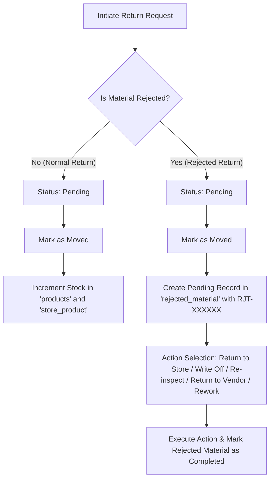

# AmNonOvens - Manufacturing Management System

## Overview
A comprehensive manufacturing management system built using a microservices-based Python and Flask architecture. Each top-level directory represents a specific service or module designed to handle a distinct part of the manufacturing lifecycle.

---

## 1. Project Structure
The project is organized into modular services:
- `bill_of_material`: Management of Bill of Materials (BOM) and component structures.
- `production_execution`: Core manufacturing floor logic, stage tracking, and execution logs.
- `cost_estimation`: Advanced logic for calculating manufacturing and material costs.
- `inventory`: Registry and management of materials and stock.
- `order_services`: Handling of customer and purchase orders.
- `delivery`: Dispatch and delivery log management (`dc.py`, line items, and dispatches).
- `dispatch`: Secondary routing/dispatch coordination.
- `dashboard`: Aggregation service for reporting and visualization.
- `qualityCheck`: Integration points for production quality assurance.
- `return_material`: Service managing the material return flow and rejected materials.
- `amdev_deployment`: Central deployment folder containing shared requirements, configs, and deployment scripts.

---

## 2. Database Schema & Table Relationships
The application interacts with a PostgreSQL database (`ipss_db`). Key tables and relationships include:

### Core Tables

#### `products`
- **Primary Key**: `product_id`
- **Key Columns**: `product_code`, `product_name`, `product_count` (global stock / In Stock), `allocated_quantity`
- **Description**: Stores global product metadata and aggregated stock counts.
  - **In Stock**: Represented directly by `product_count`.
  - **Available to Use**: Dynamically calculated as:
    $$\text{Available to Use} = \text{In Stock} - \text{allocated\_quantity}$$
  - **Stock Reversal Impact**: Manual stock adjustments do not modify `allocated_quantity`. A material return or reversal of unconsumed stock must reduce the corresponding `allocated_quantity` (releasing reservations) and adjust the location-specific `product_count` to ensure that **Available to Use** matches **In Stock**.

#### `store_product`
- **Primary Key**: `store_product_id`
- **Foreign Key**: `product_id` (references `products.product_id`)
- **Key Columns**: `store_id`, `product_count` (store-level stock / In Stock), `compcode` (tenant ID)
- **Description**: Stores the granular, store-level inventory for each product. During a stock reversal, the location-specific stock is updated.

#### `delivery`
- **Primary Key**: `deliveryid`
- **Key Columns**: `deliveryno`, `delivery_date`, `customerid`, `compcode`, `deleted`
- **Description**: Contains primary records for customer dispatches.

#### `delivery_line_items`
- **Primary Key**: `id`
- **Foreign Keys**: 
  - `deliveryid` (references `delivery.deliveryid`)
  - `workOrderLineId` (references `customer_purchase_items.items_id`)
- **Key Columns**: `quantity`, `deleted`
- **Description**: Line-level items of a delivery dispatch.

#### `customer_purchase` & `customer_purchase_items`
- **Primary Key**: `customer_purchase_id` / `items_id`
- **Key Columns**: `status` (`'Pending'`, `'Closed'`), `quantity_ordered`, `quantity_delivered`
- **Description**: Tracks customer purchase orders and order-fulfillment progress.

---

## 3. Active Database Triggers
The PostgreSQL database utilizes custom triggers to automate stock calculations and enforce constraints:

### `trg_update_product_count`
- **Table**: `delivery_line_items`
- **Timing / Event**: `AFTER INSERT OR UPDATE`
- **Function**: `update_product_count_on_delivery_items`
- **Description**: Automatically decrements the global count (`product_count`) in `products` when a new delivery line item is inserted, and increments it back when a line item is soft-deleted (`deleted = true`).

### `set_allocated_quantity_nonnegative`
- **Table**: `products`
- **Timing / Event**: `BEFORE INSERT OR UPDATE`
- **Function**: `enforce_non_negative_allocated_quantity`
- **Description**: Enforces that the `allocated_quantity` of a product cannot fall below zero.

### `rawmaterials_trigger`
- **Table**: `rawmaterials`
- **Timing / Event**: `AFTER INSERT`
- **Function**: `call_python_function`
- **Description**: Broadcasts a PostgreSQL notification (`pg_notify('new_record_added', NEW.*::text)`) when a new raw material record is inserted.

---

## 4. Local Development Setup
To configure and run the services locally:

### Step 1: Virtual Environment Setup
It is recommended to set up a single virtual environment at the **root level** of the project:

```bash
# Create the virtual environment
python3 -m venv venv

# Activate the virtual environment
# On macOS/Linux:
source venv/bin/activate
# On Windows:
venv\Scripts\activate
```

### Step 2: Install Dependencies
Install the required packages using the central configuration file:

```bash
pip install -r amdev_deployment/requirements.txt
```

Additionally, update the private API utilities package from the private repository:
```bash
pip3 install git+https://${GITHUB_TOKEN}@github.com/ekalaiv/IpssApiUtils.git --upgrade
```

### Step 3: Run a Service
Each module can be run as an individual Flask application. Navigate to the root directory and run:

```bash
# General Syntax: python <service_directory>/main.py
# Example: Running the Delivery service
python delivery/main.py
```

---

## 5. External Dependent APIs & Services
- **Private Utilities Package**: Shared decorators (e.g., `@login_required`), helpers, database clients, and serializing extensions reside in `ipss_utils`.
- **Redis Queue / Cache**: Used by the backend to store session tokens, cache frequent queries, and manage asynchronous task queues. Make sure a local Redis server is running on `127.0.0.1:6379` or configured via environment variables.

---

## 6. Foreign Data Wrapper (FDW) Tables
Currently, **no Foreign Data Wrapper (FDW) tables or servers** are configured inside the active database schema. All tables reside natively within the `public` schema of the database instance.

---

## 7. Inventory Reconciliation & Maintenance Example

This section details how `products` and `store_product` tables maintain stock counts under the hood, illustrated with active database records for **Finished Goods (Product 826)** and **Raw Material (Product 840)**.

### Case 1: Finished Goods - Tea Cake 250g (Product `826`)
* **Global Count (`products.product_count`)**: `2`
* **Location Count (`store_product.product_count`) at Central Store (ID 18)**: `2`

#### Inventory Logs (`invregistry`)
The transaction ledger logs 5 stock addition entries:
* **Release 1557**: `+2` via `plan_stock_addition` (2026-04-29)
* **Release 1579**: `+2` via `plan_stock_addition` (2026-05-08)
* **Release 1590**: `+2` via `plan_stock_addition` (2026-05-08)
* **Release 1632**: `+2` via `plan_stock_addition` (2026-06-09)
* **Release 1633**: `+2` via `plan_stock_addition` (2026-06-09)
* **Total Added**: `10`

#### Delivery Challan (DC) Dispatches (`delivery_line_items` & `delivery`)
The stock is decremented when items are shipped under a Delivery Challan:
* **DC-000001** (Release 113 / 2026-04-29): `-2` units
* **DC-000002** (Release 115 / 2026-05-08): `-2` units
* **DC-000003** (Release 116 / 2026-05-08): `-2` units
* **DC-000004** (Release 117 / 2026-06-09): `-2` units
* **Total Dispatched**: `8`

#### Reconciliation Formula
$$\text{Current Stock} = \text{Total Added (10)} - \text{Total Dispatched (8)} = \mathbf{2}$$
This perfectly reconciles with the `products.product_count` and `store_product.product_count` database counts.

---

### Case 2: Raw Material - ALMOND (Product `840`)
* **Global Count (`products.product_count`)**: `5740.0`
* **Location Count (`store_product.product_count`) at Central Store (ID 18)**: `5740.0`

#### Inventory Logs (`invregistry` & `dispatch`)
* **Release 1543**: `manual_addition` of **`+6000`** units (2026-04-29).
* **Release 1593**: `Outward` allocation of **`260.8695652`** units (2026-05-12).

#### Reconciliation Formula & Integer Casting Logic
During dispatch operations, the system casts the dispatch decimal value to an integer before updating the `products` table:
$$\text{reduced\_allocation\_amount} = \text{int}(260.8695652) = 260$$
Therefore, the database update reduces stock by exactly `260` units:
$$\text{Current Stock} = 6000 \text (Added) - 260 \text (Dispatched) = \mathbf{5740.0}$$
Both the global and store-level tables store this value, with `store_product` subsequently updated to match `products` during stock synchronization runs.

---

### Case 3: Manual Stock Adjustment (via API)
When adjusting stock manually via the endpoint `/am-invregistry/InventoryRgistry/manual_addition`:
1. **Ledger Registry (`inventory_registry` table)**:
   - A new transaction record is **inserted** to store the audit trail of the manual addition or reduction (represented with a `+` or `-` prefix in the `manual_count` field).
2. **Location Stock (`store_product` table)**:
   - The store-level stock (`product_count`) is **updated** for the corresponding `store_id` and `product_id`.
3. **Global Stock (`products` table)**:
   - The global stock (`product_count` in the `products` table) is **updated** to reflect the new aggregated count of the item.

#### ⚠️ Critical Integration Constraints:
* **Serialization (`store_serialized_products`)**: 
  Manual adjustments **do not** automatically cascade to `store_serialized_products`. If a finished good is adjusted down (e.g. to `0`), the individual serialized entries will remain in `store_serialized_products` with `status = 'Available'`. To avoid data discrepancies and dispatch validation loopholes:
  - If adjusting FG stock to `0`, the associated serials must be manually soft-deleted (`deleted = true`) or set to an inactive status (e.g. `'Adjusted'`) in the database.
  - If adjusting FG stock partially, the respective serial numbers must be cleaned up to match the physical count.
* **BOM Reduction**: 
  Manual adjustments are treated strictly as inventory corrections for the target SKU. They **do not** trigger automatic consumption, reduction, or replenishment of the raw material components defined in the product's **Bill of Materials (BOM)**.
  - Component consumption should be driven by the **Production/Execution Log** workflow.
  - If manual adjustments are used instead of the execution workflow, the component raw materials must be manually adjusted in a separate transaction.

---

## 8. Material Return & Rejection Flow

The `return_material` module manages the workflow for returning materials from production plans or packing processes back to stores. It also processes materials marked as rejected (e.g. from Quality Control) and routes them according to user action.

### Database Architecture

#### `return_material`
- **Primary Key**: `return_material_id`
- **Key Columns**: `prod_plan_id`, `packing_process_id`, `unique_id` (e.g., `RET-000001`), `product_id`, `store_id`, `return_request_amount`, `return_amount`, `status` (`'Moved'`, etc.), `is_rejected`, `rejection_action`, `rejection_store_id`, `compcode`, `deleted`
- **Description**: Stores material return requests created from production execution or packing dispatches.

#### `rejected_material`
- **Primary Key**: `rejected_material_id`
- **Key Columns**: `unique_id` (e.g., `RJT-000001`), `grnotesid`, `grnlineid`, `product_id`, `rejected_quantity`, `action` (`'Return to Store'`, `'Write Off'`, `'Re-inspect'`, `'Return to Vendor'`, `'Rework'`), `store_id`, `status` (`'Pending'`, `'Completed'`), `compcode`, `deleted`
- **Description**: Tracks materials flagged as damaged/rejected, primarily initiated during Quality Control (QC) or from rejected returns.

---

### Core Workflows



#### 1. Material Return Request (Normal)
1. **Creation**: A request is created (via `POST /am-returnMaterial/`) with a generated sequence ID `RET-XXXXXX`.
2. **Approval & Move**: When status is updated to `'Moved'` (via `PATCH /am-returnMaterial/`), the return amount is added back to inventory:
   - Increments `product_count` in the global `products` table.
   - Increments `product_count` in the store-specific `store_product` table (if `store_id` is provided).

#### 2. Rejected Return Request
1. **Creation**: Request is created with `is_rejected = True` and a chosen `rejection_action` and `rejection_store_id`.
2. **Move Execution**: When status is updated to `'Moved'` (via `PATCH /am-returnMaterial/`):
   - A new pending record is inserted into the `rejected_material` table with status `'Pending'` and a unique sequence ID `RJT-XXXXXX`.
   - Normal stock counts (`products.product_count` / `store_product.product_count`) are **not** updated at this point.
3. **Rejection Action Processing**: The rejected material workflow is followed to execute actions (e.g. `Return to Store`, `Write Off`, `Re-inspect`, `Return to Vendor`, `Rework`) and mark the record as `'Completed'`.

---

### Service API Routes (Base: `/am-returnMaterial`)

- **`/`**:
  - `GET`: List return material records with pagination and filters (`product_id`, `status`, `prod_plan_id`, `unique_id`).
  - `POST`: Create a new return material request sequence (`RET-XXXXXX`).
  - `PATCH`: Update return status. Updates inventory values for normal returns or inserts a record into `rejected_material` for rejected returns.
- **`/dispatchget`**:
  - `GET`: List active dispatches with calculated net returnable quantities (`dispatch_amount - return_amount`).
- **`/report`**:
  - `GET`: Generates production-plan grouped material return reports.
- **`/rejected/`**:
  - `GET`: List all rejected raw material records with filters.
- **`/rejected/<rejected_material_id>/`**:
  - `GET`: Retrieve details of a single rejected material entry.
  - `PATCH`: Update processing status of a rejected material (e.g. to `'Completed'`).

---

## 9. Production Plan Filtering Behavior (Start Production)

This section documents the filtering behavior for production plans in the **Start Production** execution screen and how date constraints are applied.

### Backend API Filtering
The backend endpoint `/am-prod_plans/get_production_plan` (in `production_plans/app/api/planning.py`) is used to fetch plans for the execution dropdown. 

* **Active Filters Applied:**
  * `status = 'Approved'`
  * `is_rawmaterials_received = true` (via left join check on `dispatch_flag`)
  * `is_done = false`
  * `deleted` is not true
* **Date Filtering:** The backend query does **not** filter plans by date. Although the frontend passes a `plan_date` query parameter (e.g., `&plan_date=YYYY-MM-DD`), it is ignored by the backend route handler. Consequently, all matching active plans are returned regardless of their age.

### Frontend Execution Date Constraints
While all approved/active plans are returned in the dropdown, the frontend (`Tabview.js`) restricts the allowed **Execution Date** that can be selected:
* For standard execution (`Params[2] === "execute"`), a `delayDays = 2` restriction is applied.
* This limits the date-picker’s selectable range to a **3-day window** (Today, Yesterday, and the Day Before):
  $$\text{minDate} = \text{Date.now()} - 2 \text{ days}$$
* Any plan selected from the dropdown must be executed within this allowed date range, even if the plan itself was created or scheduled earlier than the 3-day window.

---

## 10. GRN Quality Attributes & Specification Resolution

This section documents the database structure, configuration endpoints, and resolution flow for Goods Received Notes (GRN) quality check attributes.

### Database Schema

#### `quality_attributes_config`
- **Primary Key**: `id` (`BIGSERIAL`)
- **Key Columns**: `compcode` (`BIGINT`), `customer_id` (`BIGINT`, `NULL`), `raw_material_id` (`BIGINT`, `NULL`), `attribute_name` (`VARCHAR`), `attribute_type` (`VARCHAR`), `min_value` (`NUMERIC`), `max_value` (`NUMERIC`), `is_active` (`BOOLEAN`)
- **Description**: Stores quality check rules defined globally, at a material-specific level, or at a customer-material specific level.

#### `grn_qc_measurements`
- **Primary Key**: `id` (`BIGSERIAL`)
- **Key Columns**: `grn_line_id` (`BIGINT`), `spec_id` (`BIGINT` references `quality_attributes_config.id`), `measured_value` (`VARCHAR`), `is_passed` (`BOOLEAN`)
- **Description**: Stores the actual measured values for a specific GRN line item's quality checks.

---

### Specification Resolution Priority Flow (`GET /specs`)

When a GRN quality check is initiated, the `/specs` endpoint (implemented in [qc.py](file:///Users/rajkumarmuthuramalingam/Work/AmNonOvens/qualityCheck/app/api/qc.py)) resolves specs based on the following fallback hierarchy:

1. **Priority 1 (Customer-Material Specific)**: Match where both `customer_id` and `raw_material_id` match the parameters.
2. **Priority 2 (Material-Specific Default)**: Fallback to where `customer_id` is `None` and `raw_material_id` matches the target material.
3. **Priority 3 (Global Defaults)**: Fallback to where both `customer_id` and `raw_material_id` are `None` (e.g., default attributes like `Color`, `Size`, `Thickness`).

---

## 11. Omniplus Suitability Analysis for Inventory Management

Omniplus employs a relational, ledger-based database schema optimized for multi-tenant manufacturing environments. 

### Core Architecture & Stock Tracking
* **Global Stock Tracking**: Configured in `products` using `product_count` (global physical stock) and `allocated_quantity` (reserved stock). Available stock is calculated dynamically:
  $$\text{Available} = \text{In-Stock} - \text{Allocated}$$
* **Granular Store Tracking**: Configured in `store_product`, supporting `store_id` and optional text-based `sub_location` (e.g. Aisle, Rack, Shelf, Bin) using a unique index layout:
  `(product_id, store_id, COALESCE(sub_location, ''))`
* **Transaction Registry (Ledger)**: The `invregistry` table registers every `Inward`, `Outward`, and manual stock adjustment alongside status transitions (`Requested`, `Approved`, `Rejected`), providing full financial auditing capabilities.

### Strengths
1. **Double-Entry Ledger Approach**: Tracking transactions in `invregistry` avoids raw stock column updates without transaction trails.
2. **Production-Linked Allocations**: Directly maps to manufacturing flows (`prod_plan_id`), locking components dynamically for approved production plans.
3. **Trigger-Based Auto-Reconciliation**: Employs backend database triggers like `trg_update_product_count` on delivery lines to guarantee consistency.
4. **Tenant Isolation**: Strict tenant segregation (`compcode` filtering) across all endpoints and tables.

### Areas for Improvement / Roadmap Gaps
* **Serialization**: Needs robust batch or serial number tracking integrated natively across Goods Receipt Notes (GRN), Quality Control (GRNQC), and dispatches.
* **Sub-Location Validation**: `sub_location` is free-text and lacks structured schema validation (e.g. Aisle/Rack/Shelf/Bin configs).
* **Automated Reordering**: System tracks Reorder Quantity Levels (`roql`), but lacks automated alert dispatching to procurement teams.

---

## 12. Material Allocation Lifecycle & Store-Level Display

This section documents the lifecycle of material allocations, how reservations are registered, and how the system handles store-level inventory visualization.

### Allocation Lifecycle Flow

```mermaid
sequenceDiagram
    participant FE as Frontend App
    participant IR as Inventory Registry API
    participant DB as PostgreSQL Database
    participant DP as Dispatch API

    FE->>IR: Approve Request (PATCH /am-invregistry/InventoryRgistry/{releseid})
    Note over IR: store_id is NULL initially
    IR->>DB: UPDATE products SET allocated_quantity = allocated_quantity + approved_amount
    IR->>DB: INSERT INTO plan_allocation (store_id = NULL)
    Note over DB: Global allocation is active; Store-level allocation is 0
    
    FE->>DP: Dispatch Materials (POST /am-dispatch/dispatch/)
    Note over DP: User selects a physical store for dispatch
    DP->>DB: UPDATE plan_allocation SET store_id = :store_id, allocated_amount = allocated_amount - dispatch_amount
    DP->>DB: UPDATE products SET allocated_quantity = allocated_quantity - dispatch_amount
```

### Core Behaviors

#### 1. Allocation Initialization (Request Approval)
* **When**: Triggered when a Material Request (Outward) is updated to `Approved` status.
* **Database Updates**:
  * **Global Counter**: Increments `products.allocated_quantity` by the approved amount.
  * **Plan Record**: Inserts a new record in `plan_allocation` linking the `product_id` and `prod_plan_id`. Since no store is chosen at this stage, the record is created with `store_id = NULL`.

#### 2. Why Store-Specific Allocations Can Show as Zero
* In the **Stock List API** (`/am-invregistry/stocklist/`), the query aggregates allocations by store using a `LEFT JOIN` on both `product_id` and `store_id`:
  ```sql
  LEFT JOIN cte ON cte.store_id = sp.store_id AND cte.product_id = sp.product_id
  ```
* Because new allocations are created with `store_id = NULL`, the join condition `cte.store_id = sp.store_id` fails (evaluates to `NULL = store_id`).
* Consequently, newly approved allocations are displayed as `"0"` on the store-specific stock list page until they are either dispatched or resolved to a store.

#### 3. Allocation Consumption (Dispatch Execution)
* **When**: Triggered during dispatch processing.
* **Resolution**: The dispatch API matches the `plan_allocation` row (where `store_id IS NULL`), decrements the allocated amount, and updates the `store_id` to match the store from which the dispatch is made:
  ```sql
  UPDATE plan_allocation
  SET allocated_amount = allocated_amount - :qty,
      store_id = COALESCE(store_id, :store_id)
  WHERE plan_allocation_id = :plan_allocation_id
  ```
* **Release**: Decrements the global `products.allocated_quantity` by the dispatched amount. Once the allocation is fully dispatched or reverted, it is removed/resolved.