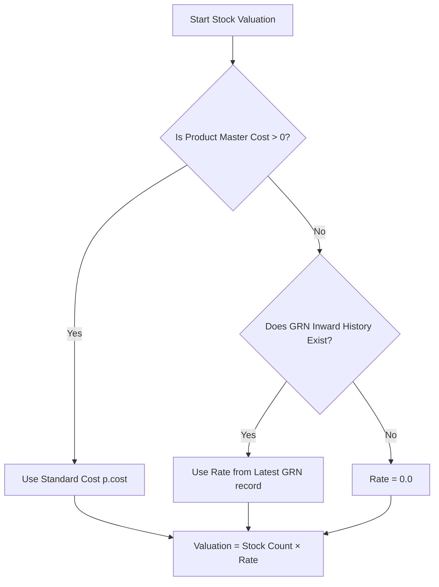

# Stock Valuation Methodology & Architecture Analysis

## 1. Executive Summary

This document details the stock valuation calculation mechanism in the `am-invregistry` service (specifically in the [`StockList`](file:///Users/rajkumarmuthuramalingam/Work/AmNonOvens/invregistry/app/api/invregistry.py#L436-L520) API endpoint), evaluates its behavior against standard accounting practices (e.g., Weighted Average Cost / FIFO), and outlines recommendations for improvements.

---

## 2. Current Implementation Analysis

In [`invregistry/app/api/invregistry.py`](file:///Users/rajkumarmuthuramalingam/Work/AmNonOvens/invregistry/app/api/invregistry.py#L469-L471), stock valuation is derived using the following SQL logic:

```sql
SELECT 
    p.product_id,
    p.product_code,
    p.product_name,
    sp.product_count,
    sl."store_name",
    COALESCE(p.cost, 0) AS unit_cost,
    COALESCE(grn_rate.last_grn_rate, 0) AS last_grn_rate,
    COALESCE(
        sp.product_count * COALESCE(NULLIF(p.cost, 0), grn_rate.last_grn_rate, 0), 
        0
    ) AS total_valuation
FROM products AS p
JOIN store_product AS sp ON sp.product_id = p.product_id
JOIN store_location AS sl ON sl.store_id = sp.store_id
...
LEFT JOIN (
    SELECT DISTINCT ON(product_id) 
        product_id, 
        rate_per_item::numeric AS last_grn_rate
    FROM grnlineitems
    ORDER BY product_id, grnotesid DESC
) AS grn_rate ON grn_rate.product_id = p.product_id
```

### 2.1 Metric Breakdown

| Metric | Source Column / Table | Resolution Logic |
| :--- | :--- | :--- |
| **`unit_cost`** | `p.cost` (`products`) | Static standard unit cost configured in the product master. Defaults to `0.0` if not set. |
| **`last_grn_rate`** | `rate_per_item` (`grnlineitems`) | The inward unit purchase rate from the **most recent GRN** (`ORDER BY grnotesid DESC`). |
| **`total_valuation`** | Computed | `product_count × Effective Rate`, where **Effective Rate** is `p.cost` (if $> 0$), otherwise `last_grn_rate`. |

---

## 3. Method Comparison: Current Approach vs. Weighted Average Cost (WAC)

> [!NOTE]
> The current system **does not** use Weighted Average Cost (WAC) or FIFO. It operates on a **Standard Cost with Latest Purchase Price (LPP) Fallback** model.



### Detailed Comparison Table

| Attribute | Current Implementation (Latest GRN / Standard Cost) | Weighted Average Cost (WAC / AVCO) | First-In, First-Out (FIFO) |
| :--- | :--- | :--- | :--- |
| **Accounting Compliance** | Suitable for operational estimates, not GAAP/IFRS compliant for statutory balance sheets. | **Standard compliant (GAAP / IFRS / AS-2)**. | **Standard compliant (GAAP / IFRS / AS-2)**. |
| **Price Volatility Impact** | High distortion: A small purchase at a higher/lower price revalues the entire historical inventory. | Low: Blends old inventory cost with new inward receipts smoothly. | Zero distortion: Consumes oldest purchase costs first. |
| **Query Performance** | Very high (`O(1)` table lookup / indexed distinct scan). | Moderate to High (requires aggregation or maintaining running average). | High complexity (requires lot/batch ledger traversal). |
| **Manufactured Goods Handling** | Relies 100% on manual `p.cost` entry in product master. | Computed based on BOM material cost + labor + overhead. | Tracks specific production batches and actual batch costs. |

---

## 4. Key Limitations & Risk Analysis

1. **Inventory Value Inflation / Deflation**:
   - *Scenario*: Company holds $1,000\text{ meters}$ purchased at ₹$30/\text{m}$ (Total Cost = ₹$30,000$). A small top-up order of $50\text{ meters}$ is purchased at ₹$40/\text{m}$.
   - *Current Result*: All $1,050\text{ meters}$ are valued at ₹$40/\text{m}$, reporting a valuation of **₹$42,000$** (an unrealized valuation gain of ₹$10,000$).
2. **Missing Tenant Filter in GRN Subquery**:
   - The subquery `SELECT DISTINCT ON(product_id) ... FROM grnlineitems` does not currently filter by `compcode = :compcode`. In multi-tenant environments, this could bleed latest GRN rates between companies if `product_id` namespaces are shared.
3. **Zero Valuation on In-House Products**:
   - In-house manufactured products do not have GRN records. If `p.cost` is left blank ($0$), the system calculates a valuation of `0.0`.

---

## 5. Recommended Implementation Approaches

### Option A: Running Weighted Average Cost (Recommended for Future Migration)

Maintain a `moving_avg_cost` column in `products` or `store_product` updated via trigger/service layer on every approved GRN:

$$\text{New Moving Average Cost} = \frac{(\text{Current Qty} \times \text{Current Avg Cost}) + (\text{GRN Qty} \times \text{GRN Rate})}{\text{Current Qty} + \text{GRN Qty}}$$

### Option B: Immediate SQL Hardening (Low Effort / High Reliability)

If maintaining the current method for operational speed, update the subquery to ensure strict company scoping:

```sql
LEFT JOIN (
    SELECT DISTINCT ON (gli.product_id) 
        gli.product_id, 
        gli.rate_per_item::numeric AS last_grn_rate
    FROM grnlineitems AS gli
    JOIN grnotes AS grn ON grn.id = gli.grnotesid
    WHERE grn.compcode = :compcode AND grn.deleted IS NOT TRUE
    ORDER BY gli.product_id, gli.grnotesid DESC
) AS grn_rate ON grn_rate.product_id = p.product_id
```
