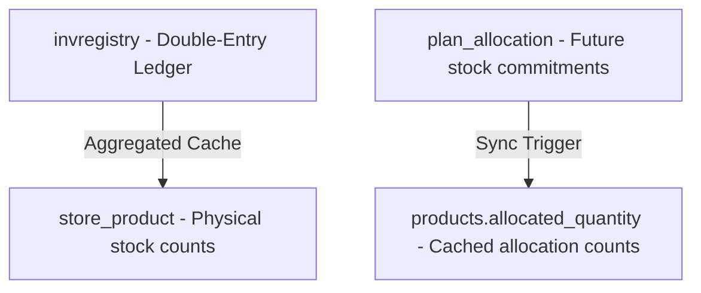

# Stock Auditing & Database Ledger Guide

This guide documents the inventory architecture, tables, and the step-by-step SQL queries needed to perform manual stock audits within the application database.

---

## 1. The Inventory Architecture

The inventory system is designed as a **Double-Entry Transactional Ledger**. 



### Key Tables & Roles
1. **`invregistry` (The Centre of the World)**:
   * **Role**: Single Source of Truth.
   * **Behavior**: Every inward shipment (GRN, returns), outward issue (dispatch, deliveries), manual addition, manual deduction, store transfer, and scrap is logged as a line item.
   
2. **`store_product` (Physical Count Projection)**:
   * **Role**: Performance cache for store-level stock counts.
   * **Behavior**: Dynamically holds the current quantities of a product in a specific store and sub-location.
   
3. **`plan_allocation` (Stock Commitment Registry)**:
   * **Role**: Tracks commitments/bookings on stock before they are physically dispatched.
   * **Behavior**: When a production plan allocates a product, a commitment row is created. When the material is physically dispatched (Outward), this row is cleared (marked as deleted).
   
4. **`products.allocated_quantity` (Global Commitment Cache)**:
   * **Role**: Caches global allocation levels per product.
   * **Behavior**: Derived from `plan_allocation` to avoid continuous summation scans during queries.

---

## 2. Step-by-Step Manual Audit Walkthrough

To audit any specific product (e.g., target `product_id = :product_id` and company code `compcode = :compcode`), follow these steps.

### Step 2.1: Calculate True Ledger Stock Balance
Query the central ledger (`invregistry`) to calculate the net stock based on approved transactions:
```sql
SELECT 
    COALESCE(SUM(CASE WHEN action = 'Inward' THEN approved_amount::numeric ELSE 0 END), 0) -
    COALESCE(SUM(CASE WHEN action = 'Outward' THEN approved_amount::numeric ELSE 0 END), 0) AS calculated_ledger_stock
FROM invregistry
WHERE product_id = :product_id 
  AND status = 'Approved' 
  AND deleted IS NOT TRUE
  AND compcode = :compcode;
```

### Step 2.2: Compare with Physical Cached Stock
Run this query to check what count is currently reported in the physical store cache (`store_product`):
```sql
SELECT 
    sp.store_id, 
    sl.store_name,
    sp.sub_location,
    sp.product_count AS cached_physical_stock
FROM store_product sp
LEFT JOIN store_location sl ON sp.store_id = sl.store_id
WHERE sp.product_id = :product_id 
  AND sp.deleted IS NOT TRUE
  AND sp.compcode = :compcode;
```
> [!NOTE]
> If `calculated_ledger_stock` from Step 2.1 does not match the sum of `cached_physical_stock` across all stores, this indicates a stock write bypass (e.g. a transaction logged to the ledger but not updated in `store_product`).

### Step 2.3: Audit Stock Allocations (Commitments)
Check how much stock is currently locked/committed to plans and cannot be released:
```sql
SELECT 
    pa.plan_allocation_id,
    pa.prod_plan_id, 
    pa.allocated_amount, 
    pa.store_id,
    sl.store_name
FROM plan_allocation pa
LEFT JOIN store_location sl ON pa.store_id = sl.store_id
WHERE pa.product_id = :product_id 
  AND pa.deleted IS NOT TRUE
  AND pa.compcode = :compcode;
```

Verify if the sum of these allocations matches the global product column:
```sql
SELECT allocated_quantity 
FROM products 
WHERE product_id = :product_id 
  AND compcode = :compcode;
```

---

## 3. Real Example Queries (populated with Feston metadata)

For customer **Feston** (`compcode = 155`), here are the pre-populated scripts for product ID `5` (Main Board):

```sql
-- 1. True Ledger Stock
SELECT 
    COALESCE(SUM(CASE WHEN action = 'Inward' THEN approved_amount::numeric ELSE 0 END), 0) -
    COALESCE(SUM(CASE WHEN action = 'Outward' THEN approved_amount::numeric ELSE 0 END), 0) AS calculated_ledger_stock
FROM invregistry
WHERE product_id = 5 
  AND status = 'Approved' 
  AND deleted IS NOT TRUE
  AND compcode = 155;

-- 2. Physical Stock Count
SELECT sp.store_id, sl.store_name, sp.product_count AS cached_physical_stock
FROM store_product sp
LEFT JOIN store_location sl ON sp.store_id = sl.store_id
WHERE sp.product_id = 5 
  AND sp.deleted IS NOT TRUE
  AND sp.compcode = 155;

-- 3. Allocation commitments
SELECT prod_plan_id, allocated_amount, store_id
FROM plan_allocation
WHERE product_id = 5 
  AND deleted IS NOT TRUE
  AND compcode = 155;
```
